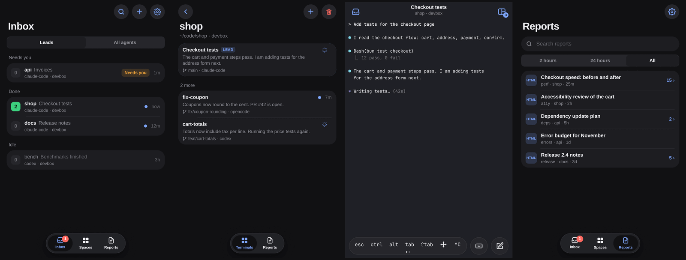

# herdr-mobile

A mobile web app for [Herdr](https://herdr.dev) agents. It shows your agents on your phone, opens their terminals and lets you reply. It is a home-screen web app, not a native app. Access is through your Tailscale network only.



## What it does

- **Inbox.** Agents that report status, in this order: pinned, needs you, done, working, idle. **Leads** (the default) shows one row for each space. The green number counts the agents at work in the space. **All agents** shows every agent. The lead of a space has the `herdr.role=coordinator` label; without it, the lead is the first pane of the first tab. Swipe right to mark read or unread, swipe left to send Esc, hold for more actions.
- **Spaces.** The lead first, then the other terminals. Each row shows the newest text from the agent, the git branch, and a spinner or the time of the last change. The bottom tabs show **Terminals** or **Reports**.
- **Terminal.** The live terminal (xterm.js) with a key bar: esc, ctrl, alt, tab, an arrow pad and ^C. **Write** sends text and photos as one paste. A mic button in **Write** dictates text.
- **Reports.** HTML, Markdown, PDF and image files under the report folders, newest first. Search, or show the last 2 hours, 24 hours or all. Pull down to scan again.
- **New and close.** Make a space (a folder and an agent), close a terminal, or close a space. Closing the last terminal of a space closes the space.

Seen and pinned state use the `herdr.seen` and `herdr.pinned` labels, so the desktop app and this app agree.

## Requirements

- [Bun](https://bun.sh), herdr-core (`hc`) on the same machine, and [Tailscale](https://tailscale.com).
- Optional: the Herdr desktop app (`herdr-app`) for new space and close. Without it, these controls do not show.
- Optional: Hex (`hex transcribe`) and `ffmpeg` for dictation. Without them, the mic does not show.

## Install

```sh
bun install
bun run build
cp scripts/herdr-mobile.service ~/.config/systemd/user/   # set WorkingDirectory to this folder
mkdir -p ~/.config/herdr-mobile && $EDITOR ~/.config/herdr-mobile/env
systemctl --user enable --now herdr-mobile
tailscale serve --bg --https=9443 http://127.0.0.1:7791
```

Then open `https://<machine>.<tailnet>.ts.net:9443` on your phone and add it to the home screen.

## Configure

Put the settings in `~/.config/herdr-mobile/env`:

```sh
HM_ALLOWED_LOGINS=you@example.com          # required: Tailscale logins
HM_ALLOWED_DEVICES=desk,my-phone           # required: Tailscale device names
HM_REPORT_ROOTS=~/reports:~/code/*/reports # report folders; "*" matches one folder level (default ~/reports)
HM_PROJECT_DIRS=~/code                     # folders with git repos for New space (default ~)
HM_HOME_FILES=1                            # open home-folder file paths that agents print (default off)
HM_LINK_PREFIXES=http://localhost:8766/files/  # URL prefixes that also point at home files
HM_PORT=7791
```

The server does not start without `HM_ALLOWED_LOGINS` and `HM_ALLOWED_DEVICES`.

## Security

- The server listens on `127.0.0.1` only. `tailscale serve` is the only way in.
- A request must have a `Tailscale-User-Login` in the allowed logins, and `tailscale whois` of the caller must give the same login and an allowed device.
- Writes need the `X-HM: 1` header. Reports have the CSP header `sandbox`, so a report cannot call the API.
- Hidden files and folders are never served.

## Try it without Herdr

```sh
bun run build && bun scripts/demo.ts   # sample data on http://127.0.0.1:7799
```

## Check

```sh
bun run check                                   # types and unit tests
bun test/e2e/stagehand.ts <url> <terminal> /tmp/hm-e2e
bun scripts/screens.ts                          # docs/screens.png from the demo (needs ImageMagick)
```

The Stagehand walkthrough runs a local Chromium at phone size. It opens only the terminal that you name, and it refuses a terminal that reports agent status. Make a test terminal with `hc run --bg --name hm-e2e bash`. Set `HM_E2E_SPEECH` to a WAV file of speech to test dictation.

## License

MIT
